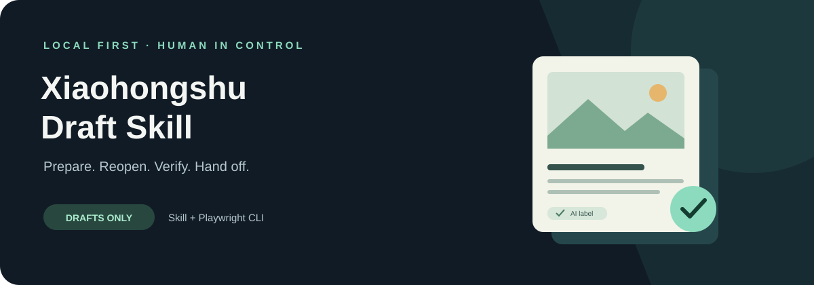

<p align="center">
  
</p>

<p align="center">
  <a href="README.zh-CN.md"><strong>简体中文</strong></a> · <strong>English</strong>
</p>
<p align="center">
  <a href="https://github.com/amatate/xiaohongshu-draft-skill/actions/workflows/test.yml"></a>
  <a href="LICENSE"></a>
  
  
</p>

# Prepare the draft. Keep the final say.

A local-first **Codex skill + Playwright CLI** for Xiaohongshu image-note drafts. Upload approved originals, preserve truthful AI labeling, reopen the result, and hand publication back to the user. No paid model API, browser extension, or cookie export is required by the CLI.

> [!IMPORTANT]
> **v0.1 is an experimental live adapter.** The original guided workflow succeeded on the real site. This rewritten package has offline/mock coverage, but has **not passed unattended real-site batch acceptance**. It does not promise UI stability, phone/cloud draft sync, or AI-detection avoidance.

<p align="center"><a href="#quick-start">Quick start</a> · <a href="#the-workflow">Workflow</a> · <a href="#safety-by-design">Safety</a> · <a href="#verification">Verification</a></p>

## Optional scheduled publishing

New: an experimental, separately opted-in command for **existing drafts**. Default remains local validation; the original draft CLI still cannot publish. Scheduling requires explicit account/content/time authorization, image and management review, durable anti-retry intent, and final management-page verification.

See the **[bilingual scheduling guide](references/scheduling.md)** for `validate`, `prepare`, and one-item `submit --reviewed`. Submit can really publish and deliberately has no draft-only network interception. The new adapter is offline-tested, not unattended live-batch certified.

## What it does

| Prepare | Verify | Hand off |
| --- | --- | --- |
| One original image per note, checked by SHA-256 | Reopen the saved draft; check title, body, AI label and image count | Open the same local profile for the user |
| Dedicated browser profile and private manifest | Capture evidence for visual image review | The user adds topics and decides whether to publish |
| Record intent before uploading | Stop on uncertain history instead of blindly retrying | Draft CLI: no Publish command; separate opt-in scheduling |

**Not a hosted service, browser extension, or unattended publishing bot.** Topic automation is intentionally excluded in v0.1. The CLI itself does not generate artwork or copy.

## Quick start

### 1 · Install

Use Node.js **22+**. From this checkout:

```sh
npm ci
npx playwright install chromium
```

Dependencies are pinned in `package-lock.json`; the second command downloads official Playwright Chromium. An existing trusted Playwright installation must match its browser version. Do not copy another person's browser profile.

<details>
<summary><strong>Register the skill in Codex</strong></summary>

Run from this checkout. Choose another destination if the name already exists:

```sh
mkdir -p "$HOME/.codex/skills"
ln -s "$PWD" "$HOME/.codex/skills/xiaohongshu-draft-skill"
```

Other skill-capable clients can load [`SKILL.md`](SKILL.md) and its linked references.

</details>

### 2 · Prepare private inputs

Create your manifest using the [input schema](references/manifest.md), **outside the repository**. Use an approved original image, its SHA-256, and accurate copy. If real topics are required, agree that the user will add them at handoff.

```sh
# Local validation only: no browser or network operation.
node scripts/xhs-drafts.cjs validate --manifest /private/work/posts.json
```

### 3 · Log in, draft, then review

```sh
# Normal user login. Close this window before automation.
node scripts/xhs-drafts.cjs human-browser --state /private/work/xhs-state

# Only after the user authorizes these uploads and drafts.
node scripts/xhs-drafts.cjs draft --manifest /private/work/posts.json --state /private/work/xhs-state

# Open the same profile for final user review and manual publication.
node scripts/xhs-drafts.cjs human-browser --state /private/work/xhs-state
```

> [!NOTE]
> Always use the **same state directory and launch method**. The default state is `~/.local/share/xiaohongshu-drafts`. State inside this repository is refused. Do not run concurrent browsers on the profile or clear its local data. A restart may require another QR login.

## The workflow

```text
Approved original + private manifest
                 │
          Validate bytes & scope
                 │
      Upload → fill → AI declaration
                 │
       Save → list → reopen → check
                 │
       Visual review of the image
                 │
       User reviews and publishes
```

### A saved status is not full acceptance

Read `last-result.json` and compare every `evidence/*-reopened.png` with its original. `reopened-needs-visual-review` means the mechanical checks passed, **not that image identity has been proved**. Draft-list covers may be placeholders even when the reopened editor is correct.

### Interrupted? Reconcile, don't repeat

```sh
node scripts/xhs-drafts.cjs reconcile --manifest /private/work/posts.json --state /private/work/xhs-state
```

Repeated runs reopen matching recorded drafts without uploading again. An uncertain attempt stops until reconciliation. A missing old draft may have been published or deleted, so it is **not recreated automatically**. Do not reset the journal or change IDs to force a retry.

## Safety by design

| Automated mode | Human handoff |
| --- | --- |
| Unknown writes denied; known publication routes denied | `human-browser` has **no network interception** |
| Publication-like buttons intercepted as defense in depth | Normal user controls are available |
| Draft CLI has no Publish command, stealth plugin or CAPTCHA solver | The user logs in, reviews and may publish personally |
| Stops on changed UI, failed checks or uncertain history | Login and draft visibility must be checked after restart |

These controls are **not a sandbox for malicious pages or a guarantee against future site changes**. Inspect changed behavior; never broadly allow writes just to make a run succeed.

> [!WARNING]
> Drafts live in this browser profile, not a guaranteed phone/cloud inbox. Profiles, manifests, artwork, authentication state and content-bearing screenshots are private. Keep them out of Git and shared backups. Manual publication is for human control, **not an AI-detection bypass**; keep accurate AI disclosures and platform labels.

## Verification

```sh
npm run check
npm test
```

Tests use isolated synthetic pages in real Chromium, with external traffic blocked. Coverage includes input hashing, network/click guards, state locks, duplicate prevention, interrupted-run recovery, and save/reopen behavior. They do not log into or mutate Xiaohongshu, and are **not live-site batch acceptance**.

## Read next

- [Skill instructions](SKILL.md) — scope, operating steps and truthful reporting
- [Private manifest format](references/manifest.md) — inputs and validation rules
- [Operational lessons](references/operating-notes.md) — what failed and how recovery works
- [MIT license](LICENSE)
