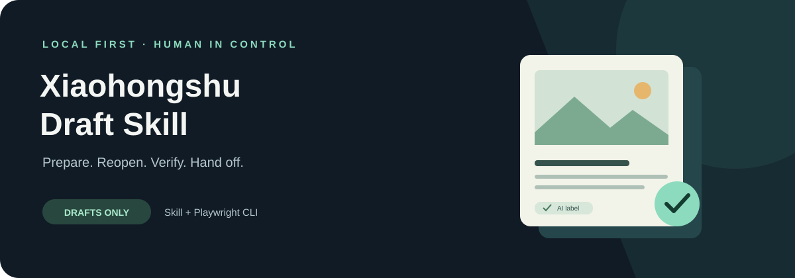

<p align="center">
  
</p>

<p align="center">
  <strong>简体中文</strong> · <a href="README.md"><strong>English</strong></a>
</p>
<p align="center">
  <a href="https://github.com/amatate/xiaohongshu-draft-skill/actions/workflows/test.yml"></a>
  <a href="LICENSE"></a>
  
  
</p>

# 草稿交给工具，发布留给你。

一个本机优先的 **Codex Skill + Playwright 命令行工具**，用于准备小红书图文草稿：上传已认可的原图、保留真实的 AI 声明、重新打开核验，再交还用户审阅发布。命令行工具本身无需付费模型 API、浏览器扩展或 Cookie 导出。

> [!IMPORTANT]
> **v0.1 是实验性的实站适配器。** 原始人工引导流程已在真实网站成功完成；重新整理的代码包有离线与模拟测试覆盖，但**尚未通过无人值守的实站批量验收**。不承诺页面长期兼容、手机／云端草稿同步或规避 AI 识别。

<p align="center"><a href="#快速开始">快速开始</a> · <a href="#工作流程">工作流程</a> · <a href="#安全边界">安全边界</a> · <a href="#验证方式">验证方式</a></p>

## 可选定时发布

新增独立显式启用的实验性命令，面向**已有草稿**。默认仍只做本地验证，原草稿命令仍不能发布。定时提交需要明确的账号／内容／时刻授权、原图与管理页检查、落盘防重记录，最后在笔记管理页核验。

完整命令和边界见 **[中英双语定时发布指南](references/scheduling.md#简体中文)**：`validate`、`prepare`、单篇 `submit --reviewed`。submit 会真的提交，刻意不安装草稿专用网络拦截；新适配器已离线测试，尚未通过无人值守实站批量验收。

## 它能做什么

| 准备 | 核验 | 交接 |
| --- | --- | --- |
| 每篇一张原图，通过 SHA-256 核对 | 保存后重开，核对标题、正文、AI 标识及图片数量 | 打开同一专用浏览器供用户使用 |
| 使用专用浏览器目录与私有素材清单 | 留下截图，供视觉核对图像身份 | 用户补充话题，决定是否发布 |
| 上传前记录操作意图 | 状态不明即停止，不盲目重试 | 草稿 CLI 不发布；定时功能单独启用 |

**它不是托管服务、浏览器扩展或无人值守发布机器人。** v0.1 有意不自动添加话题，也不负责生成图片和文案。

## 快速开始

### 1 · 安装

需要 **Node.js 22+**。在仓库根目录运行：

```sh
npm ci
npx playwright install chromium
```

依赖版本固定在 `package-lock.json`；第二条命令下载官方 Playwright Chromium。若使用已有的可信 Playwright 安装，浏览器版本必须匹配。不要复制他人的浏览器登录目录。

<details>
<summary><strong>将 Skill 注册到 Codex</strong></summary>

在仓库根目录运行。如果目标名称已存在，请换一个名称，勿覆盖已有 Skill：

```sh
mkdir -p "$HOME/.codex/skills"
ln -s "$PWD" "$HOME/.codex/skills/xiaohongshu-draft-skill"
```

其他支持 Skill 的客户端可读取 [`SKILL.md`](SKILL.md) 及其引用文档。

</details>

### 2 · 准备私有输入

按[输入格式](references/manifest.md)创建清单，**保存在仓库外**。使用获准原图、对应 SHA-256 和准确文案。如果需要真实话题，先与用户约定在发布前手动添加。

```sh
# 仅本地校验，不打开浏览器、不访问网络。
node scripts/xhs-drafts.cjs validate --manifest /private/work/posts.json
```

### 3 · 登录、存草稿、交还用户

```sh
# 用户正常登录；登录后关闭此窗口，再运行自动化。
node scripts/xhs-drafts.cjs human-browser --state /private/work/xhs-state

# 仅在用户已授权本批原图上传和草稿保存后运行。
node scripts/xhs-drafts.cjs draft --manifest /private/work/posts.json --state /private/work/xhs-state

# 用同一目录打开浏览器，供用户最终检查和手动发布。
node scripts/xhs-drafts.cjs human-browser --state /private/work/xhs-state
```

> [!NOTE]
> 始终使用**同一状态目录和启动方式**。默认目录为 `~/.local/share/xiaohongshu-drafts`，工具拒绝把状态存入本仓库。不要同时启动两个使用该目录的浏览器，也不要清理本地数据。重启后可能需要再次扫码。

## 工作流程

```text
获准原图 + 私有素材清单
           │
     校验文件与授权范围
           │
    上传 → 填写 → AI 声明
           │
    保存 → 列表 → 重开核对
           │
       视觉核验原图
           │
      用户审阅并自行发布
```

### “保存成功”不等于全部验收完成

读取 `last-result.json`，将每张 `evidence/*-reopened.png` 与原图对照。`reopened-needs-visual-review` 表示机械检查通过，**不表示工具已证明图片内容一致**。草稿列表的封面有时只是占位图，即使重开编辑器后的图片正确，也不能只看列表下结论。

### 中断后先核对，不要重新上传

```sh
node scripts/xhs-drafts.cjs reconcile --manifest /private/work/posts.json --state /private/work/xhs-state
```

重复执行会重开已有匹配记录，不再次上传。状态不明时停止，直到执行核对。旧草稿消失可能意味着用户已经发布或删除，因此**不会自动重建**。不要清空记录或换 ID 来强行重试。

## 安全边界

| 自动化模式 | 手动交接模式 |
| --- | --- |
| 拒绝未知写请求，阻止已知发布路由 | `human-browser` **不拦截网络请求** |
| 额外拦截发布类按钮点击 | 保留用户正常操作能力 |
| 草稿 CLI 无发布命令、反检测插件或验证码求解器 | 用户正常登录、检查，并可亲自发布 |
| 页面变化、核验失败、历史不明时停止 | 重启后须确认登录和草稿仍可见 |

这些措施**不是针对恶意页面的安全沙箱，也不是对未来网站变化的绝对保证**。页面变化时应检查实际行为，不能为了跑通而放开全部写请求。

> [!WARNING]
> 草稿保存在当前浏览器目录，不保证手机或云端同步。浏览器登录目录、素材清单、原图、认证状态及含正文的截图均属私有数据，请勿提交到 Git 或放入共享备份。手动发布是为了保留人的检查与控制，**不是规避 AI 识别**；必须保留准确的 AI 来源说明与平台标识。

## 验证方式

```sh
npm run check
npm test
```

测试在真实 Chromium 中运行隔离的模拟页面，阻断外部流量。覆盖文件哈希、请求及点击护栏、并发锁、去重、中断恢复与保存重开。测试不会登录或修改小红书，也**不等于实站批量验收**。

## 进一步阅读

- [Skill 操作说明](SKILL.md)（英文）：授权范围、操作步骤与结果报告
- [私有清单格式](references/manifest.md)（英文）：输入与校验规则
- [操作经验与限制](references/operating-notes.md)（英文）：失败原因、修复与恢复方法
- [MIT 许可](LICENSE)
